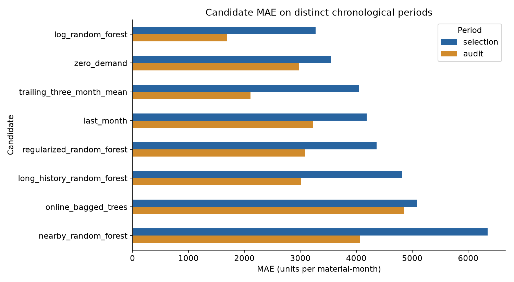

# Monthly Order Demand Forecasting

[](https://github.com/Licheng1004/ORF-forecasting/actions/workflows/ci.yml)

Forecast material-level monthly order quantities using lagged demand and revenue features with chronological model selection.

**Portfolio owner:** Licheng Xiong. **Stack:** Python, pandas, scikit-learn, Random Forest, matplotlib, Jupyter, automated verification.

## Results and evidence

The selected log-target Random Forest records **MAE 1,684.27**, versus **3,230.70** for the last-month baseline (**47.87% lower**) on September–October 2024. WAPE is **56.66%**; the model underpredicts aggregate demand (1.38M predicted vs 2.33M actual). These figures describe the retained historical snapshot.



[Executed analysis](analysis.ipynb) · [Saved audit metrics](results/run_summary.json) · [Model configuration](model_config.json) · [Legacy audit](results/legacy_audit.json)

## Project work

The project consolidates my supplied sales-order forecasting work into one maintained pipeline, including temporal-isolation fixes, candidate comparison, saved predictions and audit evidence. This repository's existing data manifest records the owner's release authorization; no additional files are introduced by the reproducibility update.

## Method

Selection uses May–August 2024 MAE across eight candidates; audit reporting uses September–October separately. Every target month is predicted from earlier months only. Twelve demand lags, rolling summaries, previous-month revenue and calendar features feed a 200-tree Random Forest trained on `log1p(quantity)`. The final forecast targets November 2024.

## Reproduce the project

Install [uv](https://docs.astral.sh/uv/getting-started/installation/), then clone this repository. The committed `.python-version` selects Python 3.12.14; `pyproject.toml` and `uv.lock` lock the direct and transitive Python dependencies. First installation requires internet access.

```sh
git clone https://github.com/Licheng1004/ORF-forecasting.git
cd ORF-forecasting
uv sync --locked
uv run --locked python forecast.py --output-dir .reproduction
```


### Verify the installation and published evidence

```sh
uv run --locked python scripts/verify.py
uv run --locked python -m unittest -v test_forecast.py
```

`--locked` rejects stale project metadata instead of silently changing the dependency versions. Select `.venv` as the Jupyter kernel in VS Code. Notebook path detection supports execution from the repository root or a notebook subdirectory. Runtime installation and synthetic checks do not reproduce a private-data competition score.

See [the reproducibility record](REPRODUCIBILITY.md) for the actual checks performed, their scope and any external prerequisites.

## Data and outputs

`data/SO.csv.gz` is a lossless compressed copy of the supplied 153,679-row sales-order snapshot, spanning January 2022–October 2024 across 392 materials. Original/stored hashes are recorded in [data_manifest.json](data_manifest.json). The source uses `MATERIAL`, `MONTH_DAY`, `QTY`, `NET_VALUE` and `NET_NET_VALUE_RMB`.

The public clone contains the required inputs and saved results. The quick command retrains/recomputes in `.reproduction/`, preserving the published `results/`. Tests independently reconcile the retained results and check temporal isolation by changing future outcomes. Use `uv run --locked python -m jupyterlab` to inspect `analysis.ipynb`; rerunning it can overwrite plots in `results/`.

## Repository map

| Path | Purpose |
| --- | --- |
| `forecast.py` | Maintained executable pipeline |
| `model_config.json` | Frozen assumptions and selected policy |
| `analysis.ipynb` | Reviewable analysis and retained outputs |
| `data/`, `data_manifest.json` | Required inputs and preservation evidence |
| `results/` | Comparison, audit and generated-result evidence |
| `test_forecast.py` | Independent regression checks |

## Limits and reuse

Only two months are held out for the audit. Missing covered months after first observation are treated as zero; extraction completeness and cold-start accuracy are unverified. Lower MAE does not imply accurate aggregate demand. No external market variables or uncertainty intervals are modeled. The evidence supports the supplied snapshot and documented assumptions. No new reuse license is granted.
